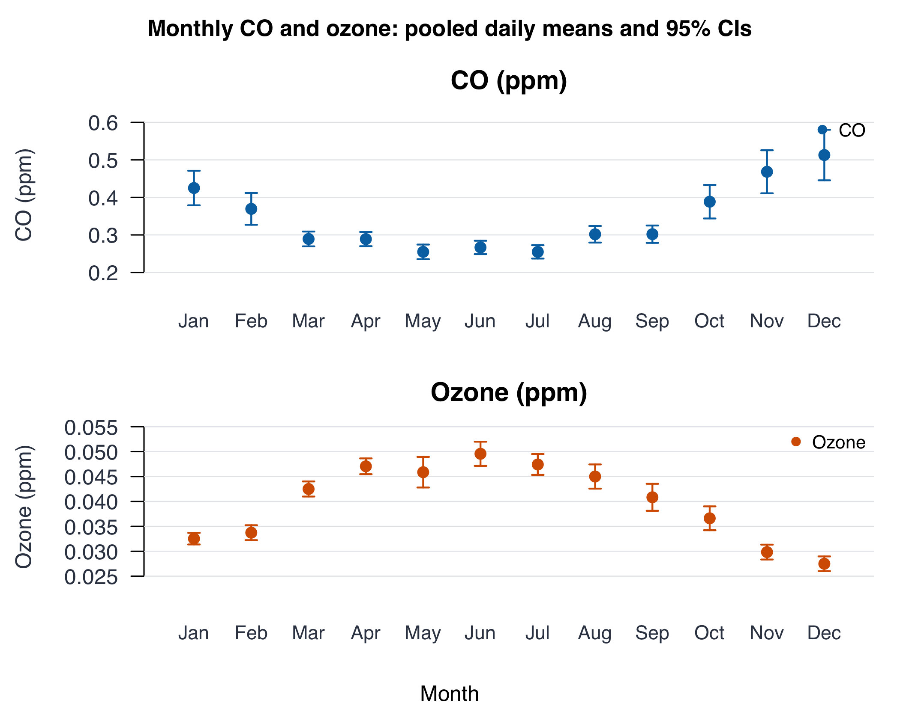
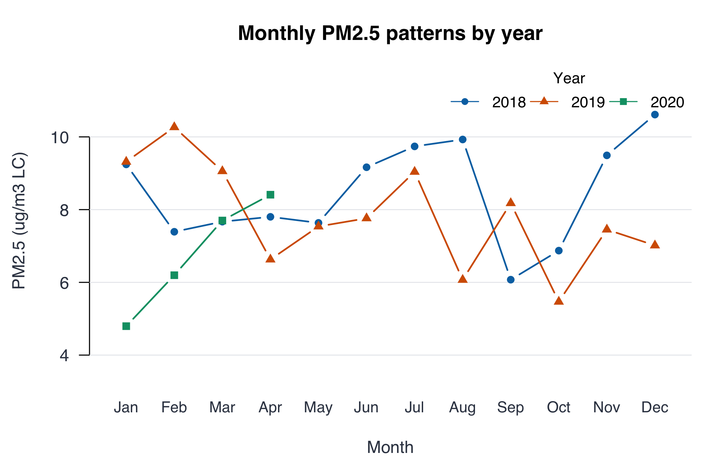

```{r setup, include=FALSE}
knitr::opts_chunk$set(echo = FALSE, message = FALSE, warning = FALSE,
                     fig.width = 7, fig.height = 4.5, dpi = 300)
source("R/analysis.R")
a <- build_analysis()
```

GitHub: <https://github.com/JinmuLiang/BIOSTATS721>

## Purpose and data

This project prepares daily air pollutant measurements from the EPA monitor at RDU airport for exploratory work motivating a sickle cell disease study in Durham County. The supplied data cover January 2018–April 2020 and contain daily maximum 8-hour CO and ozone concentrations and daily mean PM2.5 concentrations. Patient utilization data were not supplied, so this report describes exposure patterns rather than health associations.

## Data preparation

The reusable function removes exact duplicate records, parses dates, renames concentration variables, and loops over pollutants to replace negative measured concentrations with zero before calculating daily averages. Deduplication before averaging prevents repeated records from receiving extra weight; correcting negative measurements before averaging prevents them from lowering a day's average. Equal numerical values on otherwise different records remain observations because measurement identifiers are unavailable.

Daily averages use the available readings; entirely missing pollutant-days remain missing. Four absent dates (September 13–16, 2018) are represented by missing rows, and 2020 ends on April 30 without extrapolation. CO and ozone are in ppm, and PM2.5 is in micrograms per cubic meter at local conditions; the function also supports ozone output in ppb.

```{r coverage}
knitr::kable(a$audit[c("year", "raw_rows", "duplicates_removed", "calendar_days",
                      "co_days", "pm25_days", "o3_days")],
  col.names = c("Year", "Raw rows", "Duplicates", "Days", "CO n", "PM2.5 n", "Ozone n"),
  caption = "Table 1. Cleaning and coverage; n counts days with a non-missing concentration.")
```

## Annual daily concentration ranges

The following tables use cleaned daily averages and omit missing values. The 2020 table covers January–April only.

```{r ranges, results='asis'}
labels <- c(co = "CO (ppm)", pm25 = "PM2.5 (ug/m3 LC)", o3 = "Ozone (ppm)")
for (yr in 2018:2020) {
  r <- a$ranges[a$ranges$year == yr, ]
  tab <- data.frame(Pollutant = unname(labels[r$pollutant]),
                    Minimum = sprintf("%.3f", r$minimum), Maximum = sprintf("%.3f", r$maximum))
  cat(knitr::kable(tab, caption = sprintf("Table %d. %d daily concentration ranges%s.",
    yr - 2016, yr, if (yr == 2020) " (January–April)" else "")), sep = "\n")
  cat("\n\n")
}
```

## Monthly CO and ozone

Daily concentrations are pooled across all available years for each calendar month. The prescribed 95% intervals equal the mean ± 1.96 × daily standard deviation / square root of the non-missing day count. January–April include three years; May–December include two.

```{r co-ozone, fig.height=5.5, fig.cap="Figure 1. Pooled monthly mean daily CO and ozone with 95% confidence intervals."}
png("figures/co_ozone_monthly.png", width = 2100, height = 1650, res = 300)
plot_co_ozone(a$monthly)
invisible(dev.off())

```

Separate panels use independent y-axis ranges so the patterns of both pollutants are readable while preserving their ppm units. Compare seasonal timing across panels and use each labeled axis to assess concentrations.

## Monthly PM2.5 by year

```{r pm25, fig.cap="Figure 2. Monthly means of daily PM2.5 concentrations by year; 2020 ends in April."}
png("figures/pm25_monthly.png", width = 2100, height = 1350, res = 300)
plot_pm25(a$pm_monthly)
invisible(dev.off())

```

Points connected by lines emphasize the sequence of monthly means and make year-to-year patterns easy to compare without crowding the figure with daily observations.

## Interpretation

Ozone is generally higher in spring and summer than in winter, while CO tends to peak in the colder months. PM2.5 varies by year, and the January–April 2020 daily maximum (31.200 ug/m3 LC) exceeds the full-year maxima in 2018 (20.400) and 2019 (21.300), despite relatively low 2020 monthly means. January–April pooled estimates include three years but later months include only two; the prescribed intervals do not adjust for serial dependence, so seasonal comparisons and interval precision require care.

## AI use statement
After I provided the project requirements, data descriptions, proposed analytical approach, and expected outcomes, OpenAI Codex helped recommend R packages, refine the analysis workflow, and translate pseudocode into R code. I then ran the code within my R project and prepared the report in R Markdown. I also used ChatGPT to improve the clarity and professionalism of the report’s wording.
